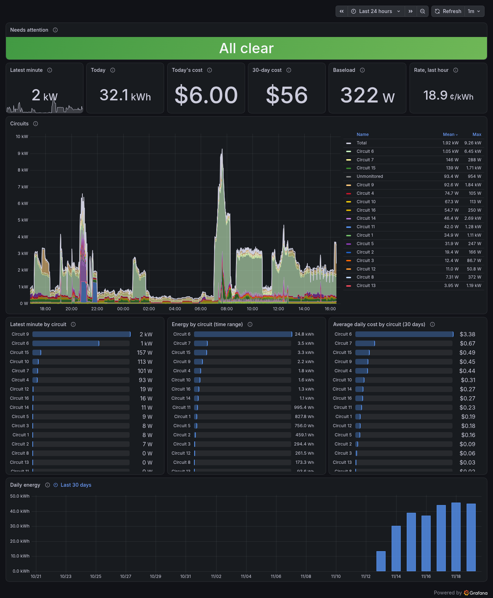

# emporiad

A Prometheus exporter for Emporia Vue energy monitors. The Vue has no local
interface, so emporiad logs in to Emporia's cloud with the app account, reads
the last complete minute of every circuit once a minute, and serves it at
`/metrics`. Go, with only `prometheus/client_golang`, like kasad, comfortd and
breezyd.

## Screenshot

The Grafana dashboard in `grafana/emporiad.json` (circuit names replaced with
numbers):



## What it reads

Every device on the account, including circuit expansions nested under a Vue
and Emporia smart plugs:

```
emporia_power_watts{device,model,channel,channel_num}   average over the last minute
emporia_cost_per_hour{device,model,channel,channel_num} that minute's cost, as a rate per hour
emporia_price_per_kwh{device,model}                     the flat price set in the app
emporia_device_connected{device,model}                  Emporia's online flag
emporia_device_info{device,model,firmware}
emporia_last_success_timestamp_seconds
emporia_poll_errors_total{stage}                        stage is devices, usage or cost
emporiad_build_info{version}
```

`channel` is the circuit name from the app. `channel_num` is `1,2,3` for the
mains, `1`..`16` for circuits and `Balance` for what no circuit sensor covers.
Energy and cost come from these rates in PromQL, for example kWh and cost
today: `sum_over_time(emporia_power_watts{channel_num="1,2,3"}[1d:1m]) / 60 / 1000`
and `sum_over_time(emporia_cost_per_hour{channel_num="1,2,3"}[1d:1m]) / 60`.

The cost is Emporia's: each poll asks for the same minute twice, in kWh and
in dollars. With a utility rate plan selected in the app, Emporia prices the
dollars with it (tiers over the billing cycle, riders); without one it uses
the flat price. Fixed monthly charges and optional programs on the bill are
not in it.

Emporia fills in the current minute late, so emporiad asks for the minute
that ended a minute ago (`--lag`). A channel with no data is left out rather
than reported as zero, and a channel's reading is dropped once it is older
than `--stale` (5 minutes), so a cloud outage shows as a gap.

## Login

Emporia uses AWS Cognito. `internal/cognito` implements the SRP login and the
token refresh with the standard library, so there is no AWS SDK. Tokens live
in memory: one login at start, a refresh every hour, and a fresh login only
when the refresh token stops working.

The credentials file has the email on the first line and the password on the
second.

## Running

```
emporiad --credentials /path/to/credentials --listen 127.0.0.1:9882
```

## NixOS

The flake has a package and a NixOS module. Add it as an input and put the
module in your system's `modules` list:

```nix
# flake.nix
{
  inputs = {
    nixpkgs.url = "github:NixOS/nixpkgs/nixos-unstable";
    emporiad = {
      url = "github:hughobrien/emporiad";
      inputs.nixpkgs.follows = "nixpkgs";
    };
  };

  outputs = { nixpkgs, emporiad, ... }: {
    nixosConfigurations.myhost = nixpkgs.lib.nixosSystem {
      system = "x86_64-linux";
      modules = [
        emporiad.nixosModules.default # services.emporiad.package defaults to this flake's build
        ./configuration.nix
      ];
    };
  };
}
```

Then configure it, for example in `configuration.nix`:

```nix
{
  services.emporiad = {
    enable = true;
    credentialsFile = "/etc/emporiad/credentials";
    prometheus.enable = true; # adds a scrape job if services.prometheus is on
  };
}
```

The credentials file holds the Emporia account email on the first line and
the password on the second. systemd hands it to the service
(`LoadCredential`), so it can stay root-only:

```sh
sudo install -d -m 700 /etc/emporiad
sudo install -m 600 /dev/null /etc/emporiad/credentials
sudoedit /etc/emporiad/credentials
```

After `nixos-rebuild switch`, metrics are on http://127.0.0.1:9882/metrics.

| Option | Default | |
|---|---|---|
| `listen` | `"127.0.0.1:9882"` | `/metrics` and `/healthz` |
| `credentialsFile` | (required) | Emporia account file |
| `pollInterval` | `"1m"` | a Go duration; a minute is Emporia's finest interval |
| `prometheus.enable`, `.jobName`, `.scrapeInterval` | `false`, `"emporiad"`, `"60s"` | auto-registered scrape job |
| `extraArgs` | `[ ]` | extra flags, e.g. `[ "--stale" "10m" ]` |

`grafana/emporiad.json` is an importable dashboard.

## Development

`go test -race ./...`. `just gate` runs the CI gate (vet, gofmt, tests, race)
on a machine with nix.

The API shapes follow [PyEmVue](https://github.com/magico13/PyEmVue).

## Licence

GPL-3.0-or-later.
